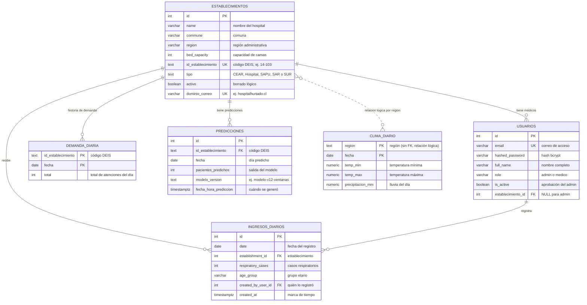
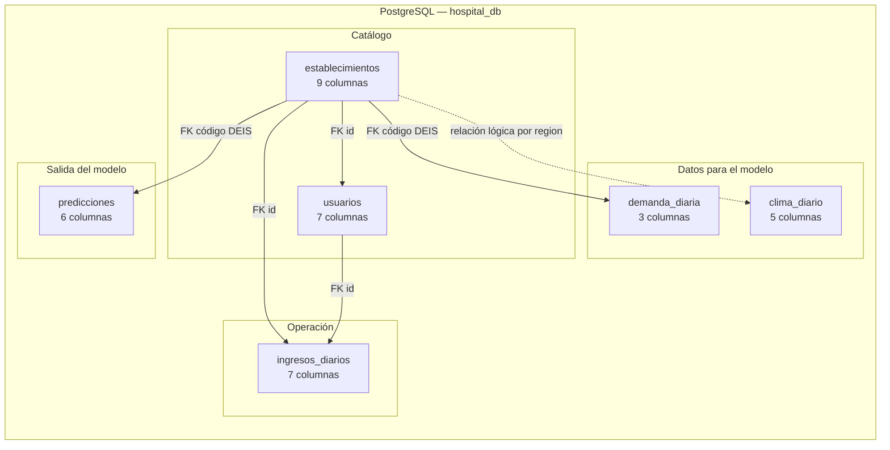

# Diagrama de base de datos — Sistema de Alerta Temprana MINSAL

Esquema extraído de los modelos SQLAlchemy en `backend/app/models/`. Las tablas
se crean automáticamente con `Base.metadata.create_all()` al iniciar la API
(`backend/app/main.py`, función `lifespan`).

> **Convención:** nombres de tabla y columna tal como existen en PostgreSQL.
> Los atributos Python de los modelos usan nombres en español y se mapean a las
> columnas en inglés; se indica cuando difieren.

---

## 1. Diagrama entidad-relación



---

## 2. Detalle de claves y restricciones

### `establecimientos`

| Columna | Tipo | Restricción |
|---|---|---|
| `id` | `integer` | **PK**, indexado |
| `name` | `varchar` | NOT NULL |
| `commune` | `varchar` | NOT NULL |
| `region` | `varchar` | NOT NULL |
| `bed_capacity` | `integer` | default 50 |
| `id_establecimiento` | `text` | **UNIQUE** (`uq_establecimientos_codigo_deis`) |
| `tipo` | `text` | CHECK ∈ {CEAR, Hospital, SAPU, SAR, SUR} |
| `activo` | `boolean` | NOT NULL, default `true` |
| `dominio_correo` | `varchar(255)` | **UNIQUE** (`uq_establecimientos_dominio_correo`) |

### `usuarios`

| Columna | Tipo | Restricción |
|---|---|---|
| `id` | `integer` | **PK**, indexado |
| `email` | `varchar(255)` | **UNIQUE**, NOT NULL, indexado |
| `hashed_password` | `varchar(255)` | NOT NULL (bcrypt) |
| `full_name` | `varchar(255)` | NULL permitido |
| `role` | `varchar(30)` | CHECK ∈ {`admin`, `medico`}, default `medico` |
| `is_active` | `boolean` | NOT NULL, default `true` |
| `establecimiento_id` | `integer` | **FK** → `establecimientos.id` `ON DELETE RESTRICT`, NULL para admin |

### `ingresos_diarios`

| Columna | Tipo | Restricción |
|---|---|---|
| `id` | `integer` | **PK**, indexado |
| `date` | `date` | NOT NULL, indexado |
| `establishment_id` | `integer` | **FK** → `establecimientos.id`, NOT NULL |
| `respiratory_cases` | `integer` | NOT NULL, CHECK ≥ 0 |
| `age_group` | `varchar(30)` | NOT NULL, CHECK con 9 valores válidos |
| `created_by_user_id` | `integer` | **FK** → `usuarios.id` `ON DELETE RESTRICT` |
| `created_at` | `timestamptz` | NOT NULL, default `now()` |

**Valores válidos de `age_group`:**
`Menores de 1`, `1-4`, `5-14`, `15-64`, `65+`, `Infantil`, `Adulto`,
`Adulto Mayor`, `General`

### `demanda_diaria`

| Columna | Tipo | Restricción |
|---|---|---|
| `id_establecimiento` | `text` | **PK compuesta**, **FK** → `establecimientos.id_establecimiento` |
| `fecha` | `date` | **PK compuesta** |
| `total` | `integer` | NOT NULL, CHECK ≥ 0 |

### `clima_diario`

| Columna | Tipo | Restricción |
|---|---|---|
| `region` | `text` | **PK compuesta** |
| `fecha` | `date` | **PK compuesta** |
| `temp_min` | `numeric` | NULL permitido |
| `temp_max` | `numeric` | NULL permitido |
| `precipitacion_mm` | `numeric` | NULL permitido |

### `predicciones`

| Columna | Tipo | Restricción |
|---|---|---|
| `id` | `integer` | **PK** |
| `id_establecimiento` | `text` | **FK** → `establecimientos.id_establecimiento`, NOT NULL |
| `fecha` | `date` | NOT NULL |
| `pacientes_predichos` | `integer` | NOT NULL, CHECK ≥ 0 |
| `modelo_version` | `text` | NOT NULL |
| `fecha_hora_prediccion` | `timestamptz` | NOT NULL, default `now()` |

**UNIQUE** (`id_establecimiento`, `fecha`, `modelo_version`) — permite que
distintas versiones del modelo coexistan para la misma fecha.

---

## 3. Relaciones

| Origen | Destino | Cardinalidad | Tipo | Nota |
|---|---|---|---|---|
| `establecimientos.id` | `usuarios.establecimiento_id` | 1 → N | **FK real** | NULL para admin |
| `establecimientos.id` | `ingresos_diarios.establishment_id` | 1 → N | **FK real** | |
| `usuarios.id` | `ingresos_diarios.created_by_user_id` | 1 → N | **FK real** | `ON DELETE RESTRICT` |
| `establecimientos.id_establecimiento` | `demanda_diaria.id_establecimiento` | 1 → N | **FK real** | Por código DEIS |
| `establecimientos.id_establecimiento` | `predicciones.id_establecimiento` | 1 → N | **FK real** | Por código DEIS |
| `establecimientos.region` | `clima_diario.region` | N ↔ N | **Lógica** | Ver nota |

### ⚠️ Por qué `clima_diario` no tiene clave foránea

`clima_diario` **no** se relaciona por clave foránea con `establecimientos`.
Tres razones técnicas:

1. **`region` no es único en `clima_diario`.** La clave primaria es compuesta
   `(region, fecha)`, y cada región aparece cientos de veces. Una clave foránea
   exige que el destino sea único.

2. **`establecimientos.region` es texto libre.** Es `varchar` sin restricción ni
   catálogo. No existe una tabla `regiones` que sirva de destino.

3. **La relación se resuelve en la capa de aplicación.** El código lo hace
   explícitamente:

   ```python
   # backend/app/api/ml_data.py:105
   row = db.get(DailyClimate, (region, day["fecha"]))
   ```

   Toma `hospital.region` y consulta `clima_diario` por esa tupla.

**Mejora futura evaluada:** crear una tabla `regiones (nombre PK)` y hacer que
ambas tablas apunten a ella. Garantizaría integridad real, pero requiere
migración de datos existentes.

---

## 4. Diagrama de despliegue de las tablas



---

## 5. Volumen de datos actual

| Tabla | Filas | Origen |
|---|---|---|
| `establecimientos` | 8 | `seed_dev.py` (catálogo de prueba) |
| `usuarios` | ~10 | `seed_dev.py` |
| `ingresos_diarios` | variable | Carga manual de médicos |
| `demanda_diaria` | ~368 | SQL de historia (45 días × 8 estabs) |
| `clima_diario` | variable | UPSERT desde Open-Meteo |
| `predicciones` | 32 | Modelo v12 (4 días × 8 estabs) |

---

## 6. Notas de implementación

**Creación del esquema:** automática al iniciar la API, con
`Base.metadata.create_all(bind=engine)` en el `lifespan` de `main.py`. No hay
migraciones versionadas (Alembic); los cambios de esquema se aplican con scripts
en `backend/sql/`.

**Script de renombrado:** `backend/sql/rename_columns_to_english.sql` documenta
una migración previa que pasó las columnas de `establecimientos` e
`ingresos_diarios` de español a inglés, conservando los atributos Python en
español.

**Idempotencia:** las cargas masivas usan `INSERT ... ON CONFLICT DO UPDATE`,
de modo que ejecutar el mismo SQL dos veces no duplica filas.
