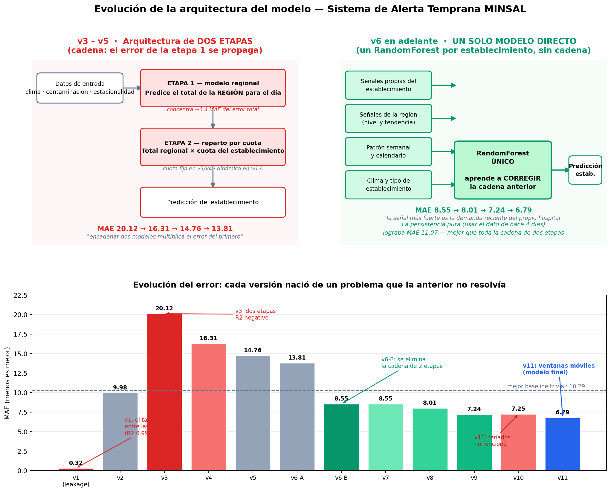

# EVOLUCIÓN DEL MODELO — explicada simple

> Para quien lee esto por primera vez: en vez de tirarte 12 versiones con
> métricas y jerga, acá está **qué cambió en cada paso y por qué**. Cada versión
> nació de un problema concreto que la anterior no resolvía.

---

## El problema de fondo

Predecir cuántos pacientes van a llegar a urgencias respiratorias, por
establecimiento y por día, con 4 días de anticipación.

Suena simple. No lo es: la primera versión parecía perfecta y era **una
mentira**. Esa historia es la mejor forma de entender por qué el proyecto pasó
por 12 versiones.

---

## La historia en una tabla

| Versión | Qué cambió | MAE | Lectura |
|---|---|---|---|
| v1 | Primera versión | 0.321 | 😍 “casi perfecto” |
| v2 | Le sacamos variables tramposas | 9.98 | 😱 el castillo se derrumbó |
| v3 | Dos modelos en cadena | 20.12 | 😖 peor todavía |
| v4 | Anomalías en vez de valores absolutos | 16.31 | 🙂 mejora |
| v5 | Anomalías que se adaptan al presente | 14.76 | 🙂 mejora |
| v6-A | Cuota dinámica | 13.81 | 🙂 mejora |
| v6-B | **Un solo modelo directo** | 8.55 | 🚀 salto grande |
| v7 | Arreglamos 3 bugs de features | 8.55 | 🔧 igual, pero ahora es real |
| v8 | Nivel y tendencia de la región | 8.01 | 🙂 mejora |
| v9 | Día de la semana | 7.24 | 🙂 mejora fuerte |
| v10 | Feriados | 7.25 | ⛔ **no funcionó** |
| v11 | Ventana móvil del establecimiento | 6.79 | ✅ mejora grande |
| **v12** | **Reentrenado con datos de 2026** | **6.83** | ✅ **modelo vigente** |

Menos MAE es mejor. MAE = cuántos pacientes nos equivocamos en promedio.

> Las cifras de este documento van **redondeadas a 2 decimales** para facilitar
> la lectura. Los valores exactos (6.7874 de MAE, 0.8283 de R2) están en
> [RESULTADOS.md](RESULTADOS.md) y en las metadatas JSON.

---

## Vista general en una imagen

Arriba a la izquierda, la **arquitectura de dos etapas** (v3–v5): predecir el
total de la región y después repartirlo entre hospitales. El problema es que el
error del primer modelo viaja al segundo y se multiplica.

Arriba a la derecha, el **modelo único** (v6 en adelante): un solo RandomForest
que mira todas las señales a la vez y predice directamente el hospital.

Abajo, la evolución del error. Se ven tres momentos clave: v1 con un MAE
sospechosamente bajo (era leakage), v3 que tocó fondo con R2 negativo, y el
salto de v6-B al eliminar la cadena.

---

## Paso a paso

### v1 — El modelo que se sacó un 7 sin estudiar

**Qué hizo:** un RandomForest que predecía el total de pacientes usando como
variables predictoras... los mismos pacientes, desglosados por edad
(`Menores_1`, `De_1_a_4`, `De_5_a_14`, `De_15_a_64`, `De_65_y_mas`).

**El problema:** el target `Total` **es la suma exacta de esas 5 columnas**.

El modelo no aprendió nada: aprendió a sumar. MAE 0.321 y R2 0.9956 son
artificialmente perfectos — es como predecir tu edad y usar como variable
predictora tu año de nacimiento.

> **Lección:** si tu modelo es casi perfecto en el primer intento, tenés un bug.

### v2 — Le sacamos la trampa y apareció la verdad

**Qué hizo:** eliminamos los 5 rangos etarios. El modelo predice con clima y
contaminación solamente.

**Qué pasó:** MAE subió a 9.98 y el R2 **se desplomó a 0.008**. Casi cero.
El modelo no explicaba nada.

**Por qué:** el clima y la contaminación se miden **por región**, no por
hospital. Todos los hospitales de una región reciben exactamente el mismo dato
de temperatura. Y las urgencias de dos hospitales de la misma ciudad ese mismo
día pueden diferir en 13 pacientes de desviación estándar. El modelo no tenía
cómo distinguirlos.

> **Lección:** un dato regional no explica una diferencia entre dos hospitales de la misma región.

### v3 — Dos modelos en cadena

**Qué hizo:** separar el problema en dos pasos. Modelo 1 predice el total de la
**región**. Modelo 2 reparte ese total entre los hospitales según la cuota
histórica de cada uno.

**Qué pasó:** MAE 20.12, R2 **negativo** (−1.98). Peor que no hacer nada.

> En el diagrama de arriba (panel izquierdo) se ve la cadena: Etapa 1 predice el
> total regional, Etapa 2 lo reparte. El error de la Etapa 1 viaja dentro del
> número que la Etapa 2 reparte.

**Por qué:** el modelo 2 repartía con la cuota de 2024 fija, pero el modelo 1
se equivocaba, y ese error se multiplicaba al repartir. Peor: la contaminación
en valor absoluto estaba confundiendo *"hay mucho smog"* con *"es invierno"*.
La contaminación subió 26%-57% de 2024 a 2025 mientras la demanda **bajaba**, y
el modelo aprendió la relación equivocada.

> **Lección:** encadenar dos modelos multiplica los errores del primero.

### v4 — Medir desvíos, no niveles

**Qué hizo:** en vez de pasarle al modelo "MP2.5 = 30", le pasa
"MP2.5 = 30, o sea 12 más de lo normal para esta época del año".

**Qué pasó:** MAE 16.31. Mejora clara, pero el R2 sigue negativo (−0.29).

**Por qué no alcanzó:** la "normalidad" estaba **congelada en 2024**. En 2025
la contaminación quedó estructuralmente más alta, y el modelo la seguía leyendo
como "anormalmente alta", empujando todas las predicciones al alza (sesgo +25%).

### v5 — Normalidad que se mueve con el tiempo

**Qué hizo:** la normalidad ya no es un promedio de 2024 fijo. Es la media de
los **últimos N días** antes de cada fecha. El modelo aprende *"más
contaminación de lo normal para esta semana → más pacientes"*.

**Qué pasó:** MAE 14.76, R2 pasó a positivo (0.141). Primer R2 que no es basura.

### v6 — Dos experimentos, un ganador claro

**v6-A:** hicimos dinámica la cuota del modelo 2. MAE 13.81. Mejora chica.

**v6-B:** tiramos la cadena de dos modelos y entrenamos **un solo modelo**
directo a nivel establecimiento. MAE **8.55**

¿Por qué funcionó? Porque el diagnóstico había mostrado que el primer modelo de
la cadena (el regional) concentraba 6.4 de MAE del error total, y todo eso se
transmitía al hospital. Además, un hallazgo clave: **usar simplemente la
demanda del mismo hospital 4 días antes** ya daba MAE 11.07 — mejor que el
sistema de dos etapas completo. La historia reciente del propio hospital es la
señal más fuerte que existe.

> **Lección:** cuando una arquitectura compleja no le gana a "usar el dato de la semana pasada", la arquitectura es el problema.

> En el diagrama, el panel derecho muestra esta arquitectura final: varias
> fuentes de señal entran a un único RandomForest, sin cadena intermedia.

### v7 — Tres bugs que hacían ruido

**Qué hizo:** no cambió la arquitectura. Arregló tres features que estaban mal
calculadas:

1. `TempMin_Lag_4D` decía ser "temperatura de hace 4 días", pero el **97.8%** de
   las filas tenía el valor de **hoy**. El cálculo avanzaba 4 filas, y hay ~152
   filas por día.
2. `Region_Media_7d_TempMin` decía "media de 7 días" pero promediaba 7 filas,
   o sea una fracción de un día.
3. El umbral de lluvia intensa se calculaba sobre **todo** el dataset,
   incluyendo el año de test.

**Qué pasó:** mismo MAE (8.55), pero ahora el número es **verdadero**. Antes era
el resultado de un modelo que creía tener información que no tenía.

> **Lección:** un modelo con features mal calculadas puede dar el número correcto por la razón equivocada. Eso es peor que un número malo.

### v8 — La región cambió de nivel y el modelo no se enteró

**Qué hizo:** agregó features que describen el **nivel y la tendencia de la
región**: cuánto atiende hoy, cuánto atendió las últimas 4 semanas, y si está
por encima o por debajo de su nivel de 2024.

**Por qué:** el sesgo por región correlacionaba −0.66 con el cambio real de
volumen entre años. Atacama cayó 17% real y el modelo la sobreestimaba 28%.
O'Higgins cayó 24% real y el modelo la sobreestimaba 27%. El modelo aprendía
los niveles de 2024 y los proyectaba, sin darse cuenta que el mundo había
cambiado.

**Qué pasó:** MAE 8.01. Atacama bajó de +28% a +16% de sesgo, O'Higgins de
+27% a +17%.

### v9 — Nadie le había dicho qué día era

**Qué hizo:** agregó el día de la semana y, sobre todo, la demanda esperada
para ese día en ese hospital.

**Por qué fue un salto grande:** el patrón semanal es **estable entre años**
(correlación 0.981) y —esto es lo importante— **Hospital y SAPU tienen perfiles
opuestos**:

| Día | Hospital | SAPU |
|---|---|---|
| Lunes | **1.18×** | 1.07× |
| Viernes | 0.94× | **0.81×** |
| Domingo | 0.92× | **1.21×** |

El hospital pega el lunes y se vacía el fin de semana. El SAPU es al revés.
Sin la feature del día, el modelo **promediaba los dos perfiles** y perdía la
señal completa.

**Qué pasó:** MAE 7.24 (−9.7%). R2 mejoró en las 16 regiones.

### v10 — La hipótesis que estaba mal

**Qué probó:** los feriados mueven la demanda +11-12% de forma estable entre
años. Parecía obvio que agregar features de feriado iba a ayudar.

**Qué pasó:** MAE 7.25. **Empeoró.**

**Por qué:** v9 **ya resolvía** los feriados. El sesgo del modelo en días
feriados era +0.28%, contra +4.77% en días normales. La demanda esperada del
hospital para ese día de la semana y la memoria reciente ya contenían el
efecto.

> **Lección:** una hipótesis plausible puede estar ya cubierta. Lo dejamos documentado para que nadie lo repita.

### v11 — El modelo solo veía un punto, no la serie

**Qué hizo:** antes de tocar el algoritmo probamos **cinco alternativas**
(RandomForest más profundo, ExtraTrees, dos variantes de
HistGradientBoosting, objetivo logarítmico, calibración isotónica). **Ninguna
ganó.** Eso nos dijo que el problema no era el algoritmo, era la información.

El diagnóstico: el error que el modelo dejaba tenía **autocorrelación de
+0.245** — había estructura temporal que no se estaba usando. El modelo conocía
la demanda de hace 4 días (un punto) y la media de 4 semanas. Le faltaba la
**forma** de la serie.

**Qué agregó:** los 7 días consecutivos (T−4 a T−10) y los estadísticos de la
ventana de 7 y 28 días (media, desvío, mínimo, máximo) más dos razones de
cambio.

**Qué pasó:** MAE **6.79**. R2 0.83. **Las 16 regiones mejoraron.** Y las
features nuevas son 7 de las 10 más importantes del modelo: `W7_mean` es la
número 1.

### v12 — El modelo necesitaba datos de este año

**Qué probó:** hasta acá todos los modelos se entrenaban con 2024 y se validaban
con 2025. Para el demo hacía falta predecir **noviembre de 2026**, un año
completo más adelante. Eso es una laguna de 11 meses respecto de los datos de
entrenamiento.

**Qué hizo:** se extendió todo el pipeline para incluir 2026:
- Descarga de temperatura, precipitación y calidad del aire de 2026 desde Open-Meteo
- Carga del archivo de atenciones del DEIS de 2026 (recortando los últimos días,
  que la fuente publica incompletos)
- Reentrenamiento con **2024 + 2025 como entrenamiento y 2026 como prueba**

**Qué pasó:** MAE **6.83**.

| | v11 | v12 |
|---|---|---|
| Entrenamiento | 2024 | 2024 + 2025 |
| Prueba | 2025 | **2026** |
| MAE | 6.787 | 6.827 |
| R2 | 0.8283 | 0.8056 |
| Sesgo | +2.57% | **+0.45%** |

**Por qué el MAE subió 0,04 (0,6%) y no es un problema:** cambió el conjunto de
prueba. v12 se valida sobre un año que el modelo **nunca vio**, mientras que v11
se validaba sobre 2025, que estaba más cerca de sus datos de entrenamiento.
Validar sobre 2026 es más exigente y más representativo del uso real.

El sesgo, en cambio, mejoró: pasó de +2,57% a **+0,45%**, es decir, el modelo
prácticamente no sobreestima ni subestima a nivel agregado.

---

## Qué se aprendió (resumen para la defensa)

1. **El primer modelo era casi perfecto, y era mentira.** El target estaba entre
   las variables predictoras. Detectar un R2 de 0.995 como sospechoso fue el
   paso más importante de todo el proyecto.
2. **Agregar complejidad no es mejorar.** La arquitectura de dos etapas (v3-v5)
   nunca le ganó a "usar el dato de hace 4 días del propio hospital". Seis
   versiones después volvimos a un modelo único.
3. **El techo estaba en las features, no en el algoritmo.** En v11 probamos
   cinco modelos distintos antes de agregar datos, y ninguno ganó.
4. **Una mejora puede ser el número correcto por la razón equivocada.** v6 daba
   8.55 con tres features corruptas. v7 dio el mismo 8.55, pero real.
5. **Las hipótesis se prueban y se descartan con evidencia.** v10 (feriados) fue
   una hipótesis razonable que no funcionó; está documentada como tal.
6. **Ajustar hiperparámetros mirando el test es hacer trampa.** Lo encontramos,
   medimos que era ruido (0.2%) y lo rechazamos.

---

## Números finales

| | Valor |
|---|---|
| MAE | **6.83** pacientes por establecimiento-día |
| R2 | **0.8056** (explica el 81% de la varianza) |
| Sesgo global | **+0.45%** |
| Cobertura | **16/16 regiones**, 657 establecimientos |
| Mejora vs v1 real | **−32% en MAE** respecto del primer modelo honesto (v2: 9.98) |
| Mejora vs v5 | **−54% en MAE** (14.76 → 6.83) |

### Comparación con baselines triviales

| Baseline | MAE |
|---|---|
| Usar el dato de hace 4 días | 10.29 |
| Promedio histórico del hospital | 10.89 |
| Promedio histórico por día de semana | 10.91 |
| **Nuestro modelo (v12)** | **6.83** |

Superamos al mejor baseline trivial por **−34%**.

---

## Lo que queda pendiente (con honestidad)

| Tema | Estado |
|---|---|
| Regresión a la media: sobreestima días flojos +122%, subestima picos −9% | Estructural del RandomForest con MSE. Requiere enfoque de cuantiles. |
| Solo dos años de datos (2024-2025) | No hay validación con 2022-2023. |
| Feriados regionales (20-sep en Coquimbo, etc.) | No modelados: el dataset no distingue comuna. |
| Dos días corruptos en el CSV de O'Higgins (−49.1 °C) | Dato fuente de SENAMHI; no se imputó. |
