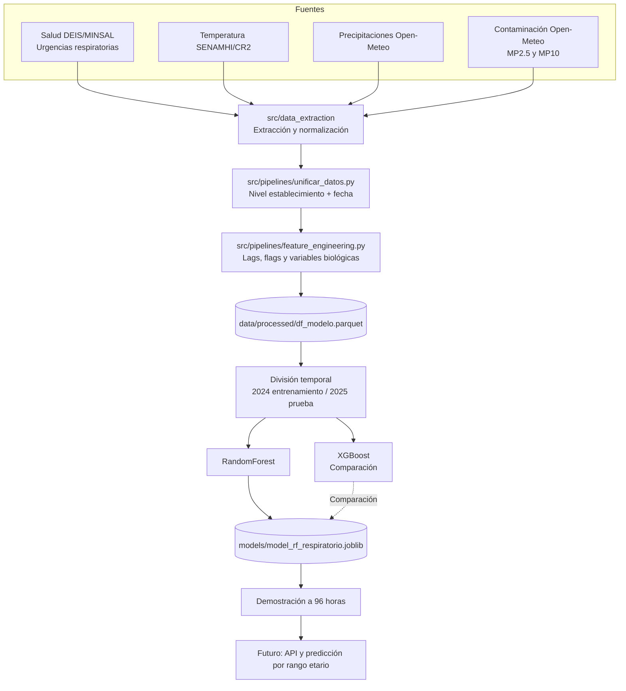

# Sistema de Alerta Temprana

Predicción de demanda en urgencias respiratorias con **96 horas de anticipación**.

Este proyecto integra datos de salud, clima y contaminación para anticipar picos de demanda respiratoria a nivel de establecimiento de salud.

## Objetivo

Pasar de una gestión reactiva de crisis respiratorias a un sistema de apoyo a decisiones con alerta temprana.

El modelo actual predice el **total de atenciones respiratorias por establecimiento y fecha**.

## Estado actual

- Integración de datos funcionando.
- Feature engineering con variables biológicas.
- Modelo RandomForest entrenado y validado.
- Notebooks separados para preparación y modelado.

## Por qué el apartado del modelo es modular

Este proyecto combina notebooks y archivos `.py`con funciones distintas:

- Los **notebooks** sirven para explorar datos, visualizar resultados y documentar decisiones y hacer demostraciones.
- Los **archivos `.py`** contienen el trabajo repetible: integración de datos, limpieza, feature engineering y entrenamiento.

Esta separación evita tener que ejecutar un notebook extenso cada vez que se modifica algo. Por ejemplo:

- Un cambio en una fuente de datos se hace en `unificar_datos.py`.
- Un cambio en un lag o alerta se hace en `feature_engineering.py`.
- El modelo puede reentrenarse usando el dataset ya procesado.

Así el proyecto es más ordenado, reproducible y fácil de mantener en equipo.

## Arquitectura

## Estructura del repositorio

Healthcare_Analytics_Project/
├── data/
│   ├── raw/
│   ├── interim/
│   ├── processed/
│   └── sample/
├── notebooks/
│   ├── 01_eda_preparacion_de_datos.ipynb
│   └── 02_modelado_predictivo.ipynb
├── src/
│   ├── data_extraction/
│   └── pipelines/
├── models/
├── docs/
│   └── PROJECT_CONTEXT.md
├── requirements.txt
└── README.md

Los datos completos y el modelo entrenado no se versionan en GitHub por su tamaño. Se comparten por un medio externo del equipo.

## Requisitos

- Python 3.13
- Dependencias indicadas en requirements.txt

## Datos y modelo

El código, notebooks y documentación se versionan en este repositorio.

Los artefactos grandes de manejan de la siguiente manera:

- Datos completos: se comparten por el medio interno del equipo.
- Modelo entrenado: se publica como evidencia versionada en GitHub Releases.
- Release actual del modelo: `modelo-v1`.

Enlace del release:

`https://github.com/bupsidu/Healthcare_Analytics_Project/releases/tag/modelo-v1`

## Reproducción del proyecto

1. Instalar dependencias.
2. Descargar datos y modelo desde los enlaces del equipo.
3. Ejecutar primero:
    - notebooks/01_eda_preparacion_de_datos.ipynb
4. Después ejecutar:
    - notebooks/02_modelado_predictivo.ipynb

El primer notebook prepara los datos. El segundo entrena y evalúa el modelo sin repetir todo el procedimiento.

## Prueba rápida

1. Cargar el modelo desde la carpeta compartida.
2. Cargar una muestra del dataset procesado.
3. Generar predicciones para establecimientos y fechas reales.
4. Comparar predicción con el total real de atenciones.

## Variables principales del modelo

- TempMin_Lag_4D
- MP2_5_Lag_2D
- Frio_Polar_Flag
- Lluvia_Intensa_Flag
- Alerta_MP25_Flag
- Tipo de establecimiento
- Región y variables climáticas regionales

## Equipo y roles

- Integrante 1 - ML y Data Science Lead:
    Ignacio Fernández
  
    Datasets, feature engineering, RandomForest, DBSCAN y modelo exportado.

- Integrante 2 - Backend y Database Lead:
    Matías Meneses
    
- Integrante 3 - Frontend y UI/UX Lead:
    Antonia Barrera

## Trabajo futuro

- Predicción por rango etario.
- API para servir el modelo.
- Reentrenamiento automático.
- Dashboard de alertas por región.

