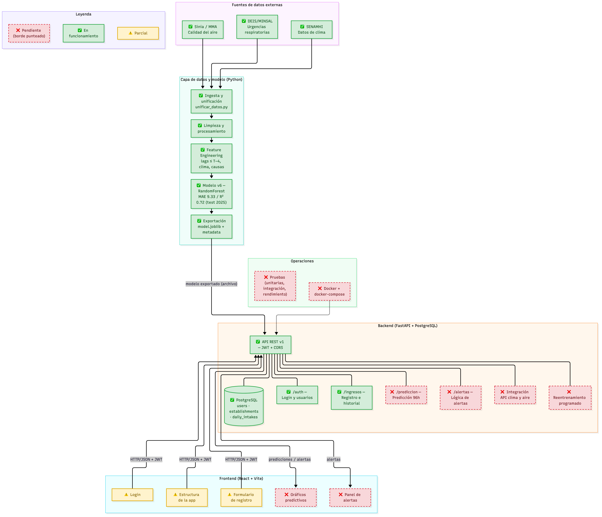
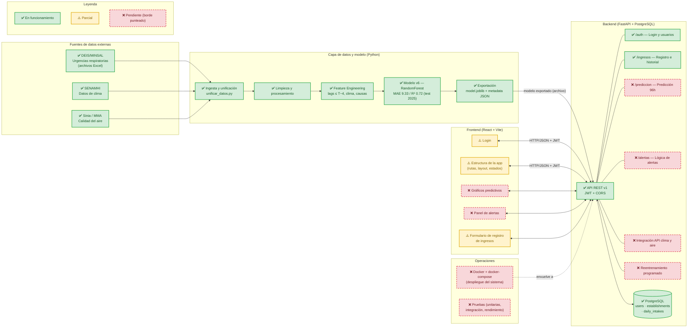

# Arquitectura del Sistema de Alerta Temprana

> Documento de arquitectura del proyecto. Describe la arquitectura **completa objetivo** del sistema y marca el estado real de implementación de cada componente.

**Leyenda de estados:**

| Símbolo | Significado |
|---|---|
| ✅ | En funcionamiento |
| ⚠️ | Parcialmente implementado |
| ❌ | Pendiente (diseñado, no construido aún) |

---

## 1. Diagrama de arquitectura

> Versión imagen (para presentaciones): [`arquitectura_estado.png`](./arquitectura_estado.png)

---

## 2. Componentes

### 2.1 Capa de datos y modelo (ML) — ✅ en funcionamiento

| Componente | Tecnología | Estado |
|---|---|---|
| Ingesta de datos (salud, clima, contaminación) | Python / pandas | ✅ ~894.650 registros, 339 establecimientos, 8 regiones |
| Limpieza y procesamiento | Python | ✅ |
| Feature Engineering | Python | ✅ lags de demanda (anti-leakage ≤ T−4), variables climáticas, causas, one-hot de establecimiento y edad |
| Entrenamiento y selección de modelos | scikit-learn (RandomForest) | ✅ v1 → v6; modelo oficial v6 (modelo directo E2) |
| Métricas (test 2025, nivel establecimiento + día) | — | ✅ MAE 9.33 · RMSE 13.05 · R² 0.72 · +9.77% vs. baseline |
| Exportación del modelo | joblib + JSON | ✅ `model.joblib` + `model_metadata.json` (+ release enlazado en README) |

**Detalles de diseño:**

- Horizonte de predicción: **96 horas** por establecimiento y fecha.
- Granularidad: establecimiento + fecha (hasta ~4 filas multi-causa por combinación; se suman).
- Separación train/test: **entrenamiento 2024 / test 2025**.
- Variables climáticas y de contaminación: por región y fecha.
- Sin escalado de features: el modelo es de árboles (RandomForest), no lo requiere.

### 2.2 Backend (FastAPI + PostgreSQL)

| Componente | Ruta / pieza | Estado |
|---|---|---|
| API REST base (CORS, OpenAPI, lifespan) | `app/main.py` | ✅ |
| Autenticación JWT y gestión de usuarios | `app/api/auth.py` | ✅ |
| Healthcheck | `app/api/health.py` | ✅ |
| Registro de ingresos diarios e historial | `app/api/intakes.py` | ✅ |
| Base de datos (usuarios, establecimientos, ingresos) | SQLAlchemy + PostgreSQL | ✅ |
| **Endpoint de predicción** (96h) | `/prediccion` | ❌ |
| **Lógica de alertas** | `/alertas` | ❌ |
| **Integración API de clima y calidad del aire** | servicios externos | ❌ |
| **Reentrenamiento del modelo** | job programado | ❌ |

**Comunicación ML ↔ Backend:** el modelo viaja como **archivo exportado** (`.joblib` + metadata JSON). El backend lo carga para servir predicciones. Es un intercambio por artifact, no un servicio en línea de entrenamiento.

### 2.3 Frontend (React + Vite + Tailwind)

| Componente | Estado |
|---|---|
| Configuración del proyecto (Vite, Tailwind, Recharts) | ✅ |
| Login | ⚠️ |
| Estructura de la aplicación (rutas, layout) | ⚠️ |
| Formulario de registro de ingresos | ⚠️ |
| Gráficos predictivos | ❌ (solo datos de prueba) |
| Panel de alertas | ❌ |
| Integración real con el backend (consumo de API) | ⚠️ (variables de entorno listas) |
| Despliegue del frontend | ❌ |

### 2.4 Operaciones (pendiente)

| Componente | Estado |
|---|---|
| Dockerfile(s) + docker-compose | ❌ |
| Variables de entorno documentadas (`.env.example`) | ❌ |
| Guía de levantamiento en README | ❌ |
| Pruebas (unitarias, integración, rendimiento, seguridad) | ❌ |

---

## 3. Comunicación entre servicios

| Desde | Hasta | Protocolo / mecanismo | Estado |
|---|---|---|---|
| Frontend | Backend | HTTP/JSON con **JWT** (Bearer token); CORS por variable de entorno | ✅ (login) · ❌ (predicción/alertas) |
| Backend | PostgreSQL | SQLAlchemy ORM (sesiones gestionadas con FastAPI `Depends`) | ✅ |
| Modelo ML | Backend | Exportación de archivo (`model.joblib` + metadata JSON) | ✅ exportación · ❌ consumo en endpoint |
| Fuentes externas (DEIS/clima/aire) | Pipeline ML | Ingesta **batch** desde archivos (no es un servicio en tiempo real) | ✅ |
| Backend | APIs de clima y calidad del aire | Llamadas HTTP a servicios externos | ❌ |

---

## 4. Flujo de datos end-to-end (estado actual)

1. **Batch ML:** los archivos de salud, clima y contaminación se unifican, limpian y transforman en features; se entrena y evalúa el modelo; se exporta el artifact. ✅
2. **Registro:** el usuario se autentica (JWT) y registra ingresos diarios desde el frontend → backend → PostgreSQL. ⚠️ (login y API listos; formulario de registro en progreso)
3. **Predicción:** el backend carga el modelo y expone predicciones a 96h para cada establecimiento. ❌
4. **Alertas:** con la predicción, el backend evalúa umbrales y el frontend muestra el panel de alertas. ❌
5. **Reentrenamiento:** reentrenamiento periódico del modelo con datos nuevos. ❌
6. **Despliegue:** el sistema completo se levanta con docker-compose. ❌

---

## 5. Próximos pasos (por criticidad)

1. **Endpoint de predicción** en FastAPI cargando el modelo v6 — conecta el trabajo de ML con el producto.
2. **Integración de clima/aire** en el backend (habilita features en tiempo casi real para la predicción).
3. **Lógica de alertas** backend + panel de alertas y gráficos predictivos en el frontend.
4. **Reentrenamiento** programado.
5. **Docker** (Dockerfile + docker-compose + variables de entorno) y **pruebas**.
6. Despliegue del frontend e integración final frontend–backend.
