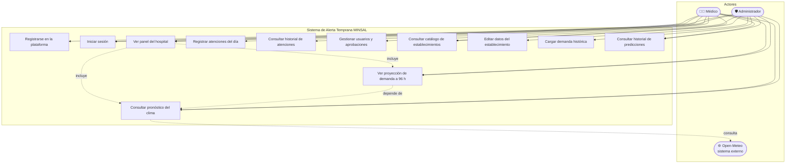
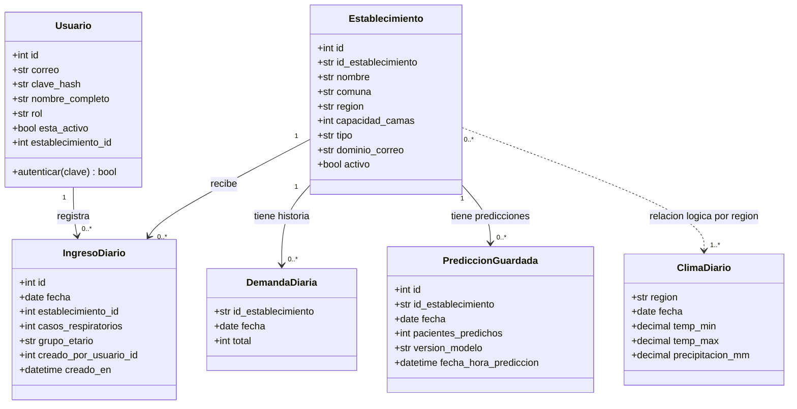
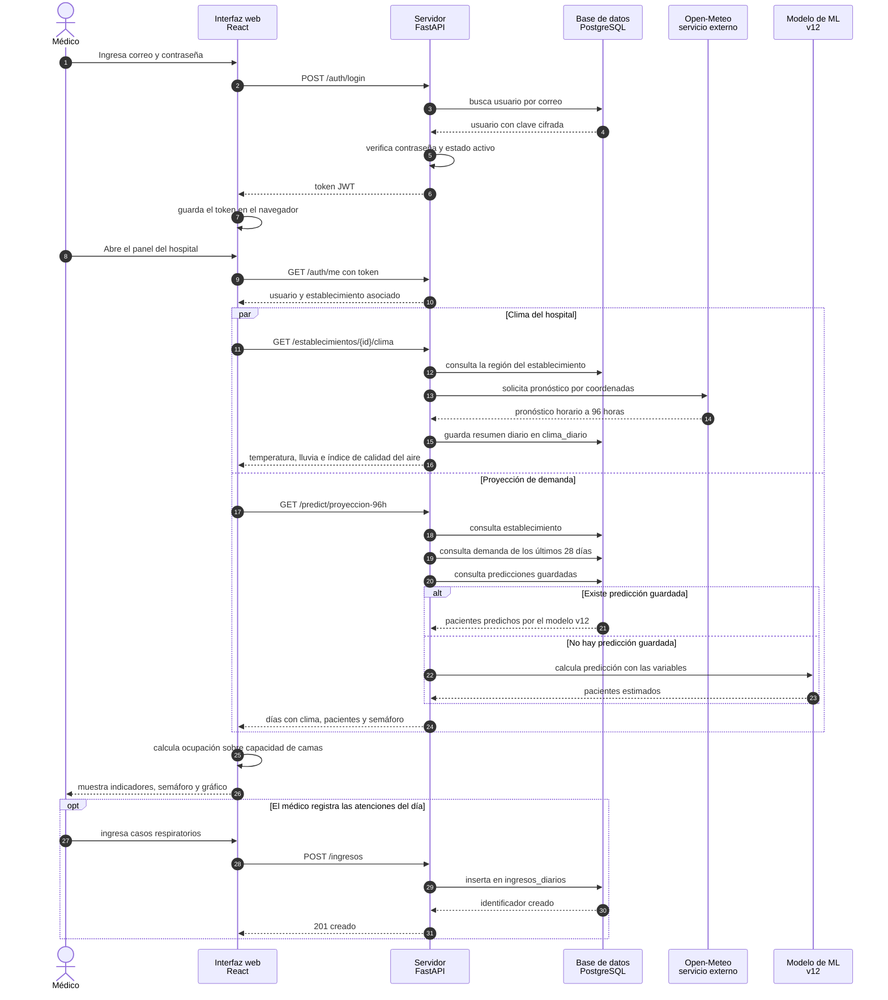
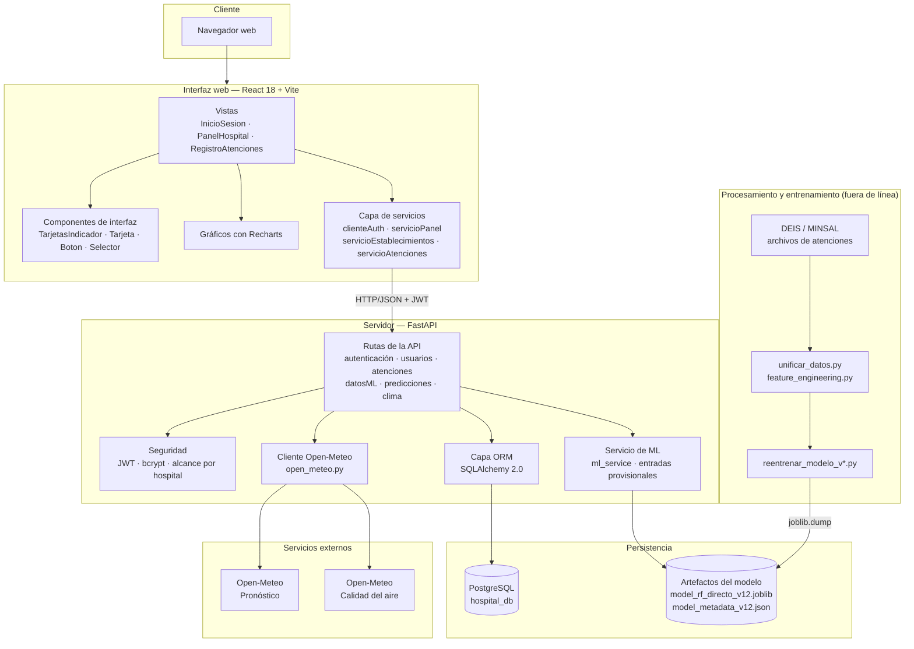
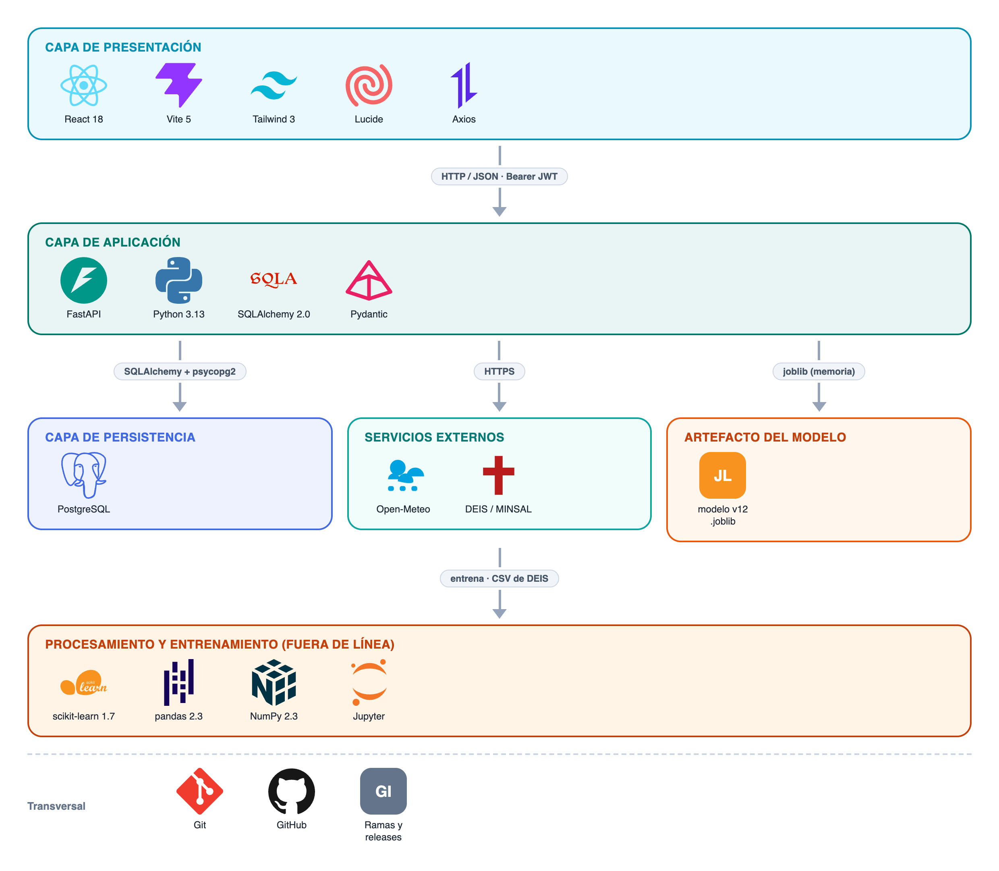
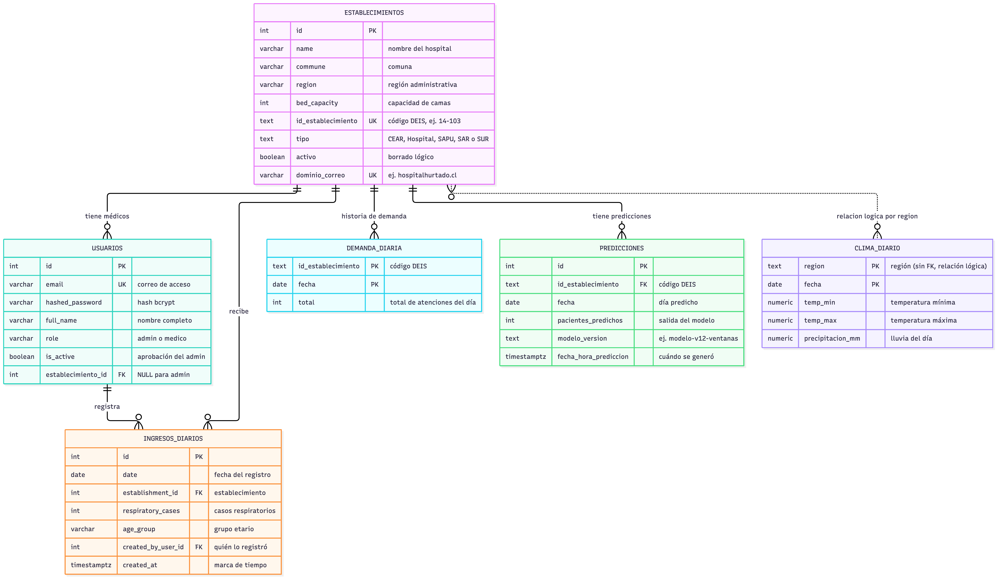

# Diagramas UML — Sistema de Alerta Temprana MINSAL

Diagramas basados en el **código real** del repositorio (verificado contra
`backend/app/api/`, `backend/app/models/` y `frontend/src/`).

> **Convención de idioma:** todo el contenido está en español, salvo los
> nombres de tecnologías, que se mantienen en su idioma original (React,
> PostgreSQL, FastAPI, etc.).

Los diagramas están en **Mermaid**, que se renderiza nativamente en GitHub.
Las versiones en PNG están en [`png/`](png/).

---

## 1. Diagrama de casos de uso



**Notas de implementación:**

- **Médico**: solo accede a su propio hospital (función `hospital_scope`).
- **Administrador**: ve todos los establecimientos y gestiona usuarios.
- El registro (`POST /auth/register`) crea cuentas **inactivas**; un
  administrador debe aprobarlas (`PATCH /usuarios/{id}`) antes del primer inicio
  de sesión.
- El clima y la calidad del aire provienen de **Open-Meteo**, consultado en vivo
  desde el backend, no desde el navegador.

---

## 2. Diagrama de clases

Los nombres de clases y atributos corresponden a los del código Python
(`backend/app/models/`). Las columnas en inglés de la base de datos se indican
en los comentarios cuando difieren.



**Equivalencias con la base de datos:**

| Clase | Tabla | Nota |
|---|---|---|
| `Usuario` | `usuarios` | Columnas: `email`, `hashed_password`, `full_name`, `role`, `is_active` |
| `Establecimiento` | `establecimientos` | Columnas: `name`, `commune`, `bed_capacity` |
| `IngresoDiario` | `ingresos_diarios` | Columnas: `date`, `respiratory_cases`, `age_group` |
| `DemandaDiaria` | `demanda_diaria` | PK compuesta `(id_establecimiento, fecha)` |
| `ClimaDiario` | `clima_diario` | PK compuesta `(region, fecha)` |
| `PrediccionGuardada` | `predicciones` | Única por `(id_establecimiento, fecha, version_modelo)` |

**Relaciones clave para la defensa:**

| Relación | Tipo | Justificación |
|---|---|---|
| `Usuario` → `IngresoDiario` | Clave foránea real | `creado_por_usuario_id → usuarios.id` |
| `Establecimiento` → `IngresoDiario` | Clave foránea real | `establecimiento_id → establecimientos.id` |
| `Establecimiento` → `DemandaDiaria` | Clave foránea real | por `id_establecimiento` (código DEIS) |
| `Establecimiento` → `PrediccionGuardada` | Clave foránea real | por `id_establecimiento` |
| `Establecimiento` ↔ `ClimaDiario` | **Lógica, no clave foránea** | Se unen por el texto `region`. `clima_diario` tiene clave primaria compuesta `(region, fecha)` y `region` no es único, así que no puede ser destino de una clave foránea. La integridad se garantiza en la capa de aplicación. |

---

## 3. Diagrama de secuencia — funcionalidad principal

Caso de uso central: **un médico consulta el panel y ve la proyección de demanda
de su hospital**.



---

## 4. Diagrama de componentes



---

## 5. Mapa tecnológico

### 5.1 Mapa tecnológico



El diagrama muestra las **seis capas del sistema y cómo se conectan**, con los
logos oficiales de cada tecnología y el protocolo sobre cada flecha:

| Conexión | Protocolo |
|---|---|
| Navegador → React | HTML, CSS y JavaScript servidos por Vite |
| React → FastAPI | HTTP/JSON con token Bearer JWT (Axios) |
| FastAPI → PostgreSQL | SQLAlchemy 2.0 sobre psycopg2 |
| FastAPI → Open-Meteo | HTTPS |
| FastAPI → artefacto del modelo | `joblib` cargado en memoria al iniciar |
| Procesamiento → artefacto | `joblib.dump` tras el entrenamiento |
| DEIS/MINSAL → Procesamiento | archivos CSV con carga manual |

Las tecnologías sin logo publicado en Simple Icons — Uvicorn, Recharts,
python-jose, bcrypt, pgAdmin y joblib — se representan con su color de marca y
una abreviatura. Los logos de Open-Meteo y DEIS son SVG propios, porque esos
proyectos no publican uno oficial.

### 5.2 Tabla de tecnologías con justificación

| Capa | Tecnología | Versión | Por qué se eligió |
|---|---|---|---|
| **Interfaz web** | React | 18.2 | Componentes reutilizables, ecosistema maduro |
| | Vite | 5.4 | Compilación rápida y recarga instantánea en desarrollo |
| | Tailwind CSS | 3.4 | Estilos utilitarios sin hojas CSS dispersas |
| | Recharts | 3.10 | Gráficos declarativos integrados con React |
| | Axios | 1.20 | Cliente HTTP con interceptores para el token |
| | Lucide React | 1.55 | Iconografía consistente y liviana |
| **Servidor** | FastAPI | 0.141 | Asíncrono, validación automática, documentación OpenAPI |
| | Uvicorn | 0.30+ | Servidor ASGI de alto rendimiento |
| | SQLAlchemy | 2.0 | ORM tipado, control de transacciones |
| | Pydantic | 2.x | Validación de contratos en los bordes |
| | python-jose | 3.3+ | Firma de tokens JWT (HS256) |
| | bcrypt | 5.0+ | Cifrado de contraseñas con sal |
| | psycopg2 | 2.9+ | Controlador de PostgreSQL |
| **Base de datos** | PostgreSQL | — | Integridad referencial y `ON CONFLICT` para cargas idempotentes |
| **Aprendizaje automático** | scikit-learn | 1.7.2 | `RandomForestRegressor`, métricas y validación |
| | pandas | 2.3.3 | Manipulación de series temporales |
| | NumPy | 2.3.5 | Cálculo vectorizado |
| | joblib | 1.5.2 | Serialización eficiente del modelo |
| **Datos externos** | Open-Meteo Pronóstico | API | Clima y pronóstico sin clave de API |
| | Open-Meteo Calidad del aire | API | MP2.5 y MP10 por coordenada |
| | DEIS / MINSAL | Archivos CSV | Atenciones reales de urgencia respiratoria |
| **Herramientas** | Python | 3.13 | Entorno del procesamiento y del servidor |
| | Git / GitHub | — | Control de versiones y publicación de releases |
| | pgAdmin | — | Administración de PostgreSQL |
| | Jupyter | — | Análisis exploratorio y experimentación |

---

## Diagrama de base de datos

El esquema completo, con claves, restricciones y relaciones, está en
[`base_de_datos.md`](base_de_datos.md).



---

## Imágenes exportadas

Los 6 diagramas están renderizados como PNG de alta resolución en [`png/`](png/):

| Archivo | Diagrama |
|---|---|
| [`png/casos_de_uso.png`](png/casos_de_uso.png) | Casos de uso |
| [`png/diagrama_de_clases.png`](png/diagrama_de_clases.png) | Diagrama de clases |
| [`png/secuencia_dashboard.png`](png/secuencia_dashboard.png) | Secuencia del panel |
| [`png/componentes.png`](png/componentes.png) | Componentes |
| [`png/mapa_tecnologico.png`](png/mapa_tecnologico.png) | Mapa tecnológico |
| [`png/base_de_datos.png`](png/base_de_datos.png) | Base de datos (ER) |
| [`png/base_de_datos_relaciones.png`](png/base_de_datos_relaciones.png) | Relaciones entre tablas |

Los **logos oficiales** en SVG están en [`logos/`](logos/), tomados de
[Simple Icons](https://simpleicons.org) (licencia CC0).

---

## Cómo exportar los diagramas

**GitHub**: los bloques Mermaid se renderizan automáticamente al ver este archivo.

**PNG o SVG**:

```bash
npx @mermaid-js/mermaid-cli -i diagrama.mmd -o diagrama.png -b white -s 2
```

**VS Code**: extensión *Markdown Preview Mermaid Support*.

---

## Nota sobre fidelidad al código

Cada elemento corresponde a código que existe:

- **Rutas de la API**: 20 rutas verificadas en `backend/app/api/*.py`.
- **Entidades**: `backend/app/models/{user,establishment,intake,ml_data}.py`.
- **Roles**: restricción real `CHECK role IN ('admin', 'medico')`.
- **Servicios externos**: URLs reales en `backend/app/services/open_meteo.py`.
- **Versiones**: `backend/requirements.txt` y `frontend/package.json`.

### ⚠️ Estado de las ramas

Este documento se generó sobre la rama `branch-nacho`, que **no incluye el
frontend más reciente** de la compañera de interfaz. Los componentes
`DashboardSection.jsx` y `KpiCards.jsx` existen en `origin/Branch-Anto` y están
reflejados en el diagrama de componentes, pero no están en este checkout local.

La rama `main` sí tiene el backend completo (`ml_service`, `ml_data`,
`predictions`, `open_meteo`). El frontend completo se integra al mergear
`Branch-Anto`.

Si el diagrama se presenta antes de ese merge, conviene aclarar que los
componentes de la interfaz corresponden al diseño ya implementado en la rama de
la compañera.

---

## Regenerar el mapa tecnológico

El mapa con logos está renderizado como PNG en `png/mapa_tecnologico.png`
(2512×1988 px). Para regenerarlo tras cambiar logos o tecnologías:

```bash
python3 docs/uml/generar_mapa_tecnologico.py
```

El script lee los SVG de `logos/` y compone la imagen por capas.

> Los logos se obtuvieron de [Simple Icons](https://simpleicons.org) (licencia
> CC0, uso libre) y se guardaron localmente para que el proyecto no dependa de
> un CDN externo.
